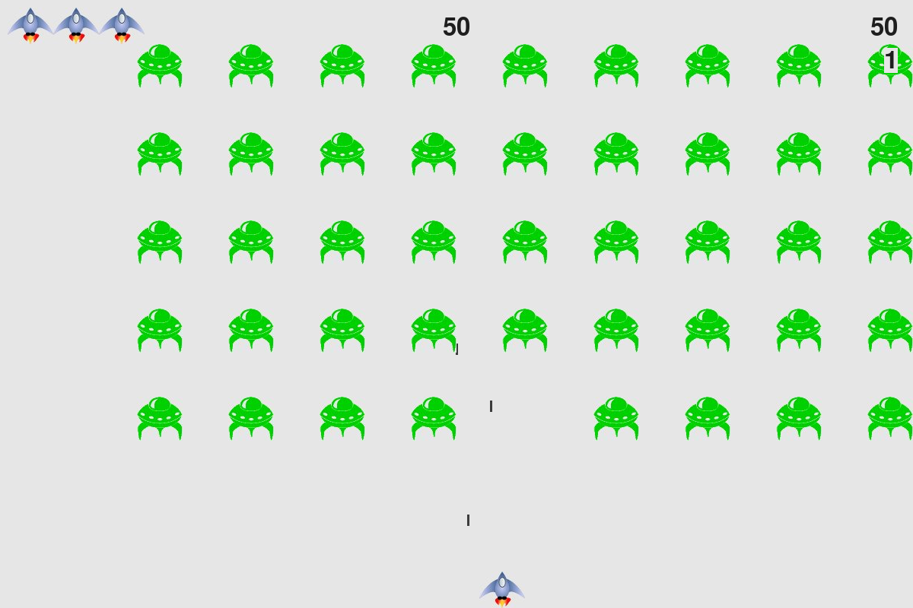

# Alien Invasion

A Python and pygame space shooter. Destroy the alien fleet before it reaches the bottom of the screen. Each kill earns XP, and leveling up increases your bullet damage. Aliens also get tougher and worth more XP as your level rises.



## Setup

Requires Python 3.10 or newer.

```bash
python -m venv .venv
source .venv/bin/activate        # Windows: .venv\Scripts\activate
pip install -r requirements.txt
python alien_invasion.py
```

## Controls

| Key | Action |
|---|---|
| Left / Right arrow | Move ship |
| Space | Fire |
| Q | Quit |

Click **Play** to start a new session (XP resets). Click **Replay** after losing to keep your XP.

## Design notes

**XP and levels.** Level 2 starts at 100 XP. Each later level needs 1.5 times the total XP of the previous one (`XPSystem` in `xp_system.py`). Early levels arrive quickly, and later ones take longer.

**Scaling with level.** Aliens gain health by a factor of 1.3 per level and drop 1.5 times more XP per level. Ship damage rises by 0.5 per level. Because damage is computed from the level rather than stored, the upgrade can't fall out of sync with the XP system.

**Difficulty per wave.** Clearing a fleet speeds up the ship, bullets, and aliens by 10%, and raises the point value of each alien by 50%. All tuning values are in `settings.py`.

**Bullets.** Each bullet is used up on its first hit. Aliens can take several hits before dying, so higher levels require more shots per kill.

## Project structure

| File | Purpose |
|---|---|
| `alien_invasion.py` | Main loop, input handling, collisions, game states |
| `settings.py` | All tunable values |
| `game_stats.py` | Score, lives, wave, high score |
| `xp_system.py` | XP and level (single source of truth) |
| `ship.py`, `alien.py`, `bullet.py` | Sprites |
| `scoreboard.py`, `button.py` | On-screen UI |

## Known limitations

- Alien images are loaded from disk for every alien. Caching the image once would be faster.
- The score display rounds to the nearest 10, which is a display choice, not a scoring rule.
- The wave counter starts at the player's XP level, so it can be confusing to read as a separate measure. A future version could track waves and levels separately.
